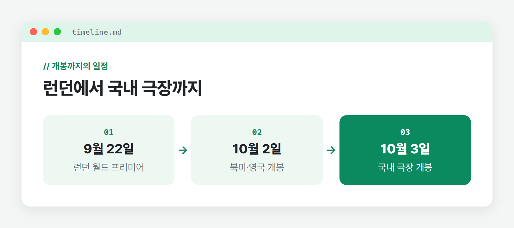
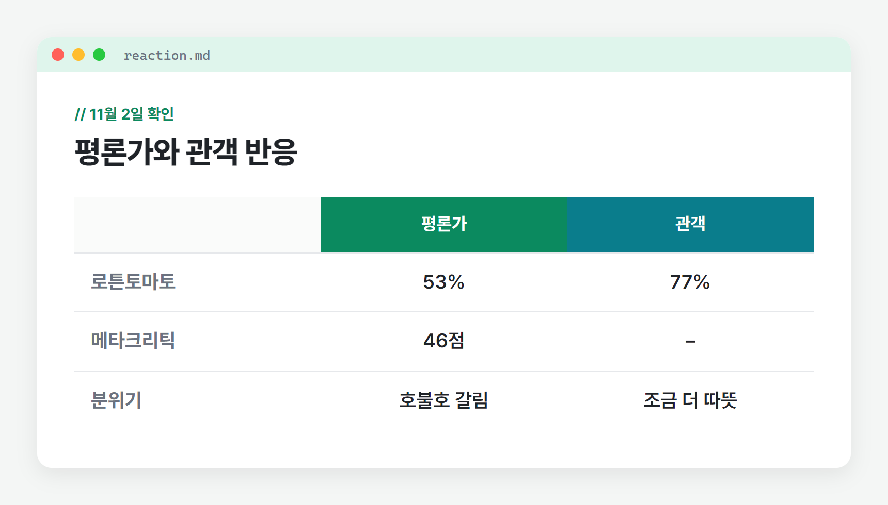
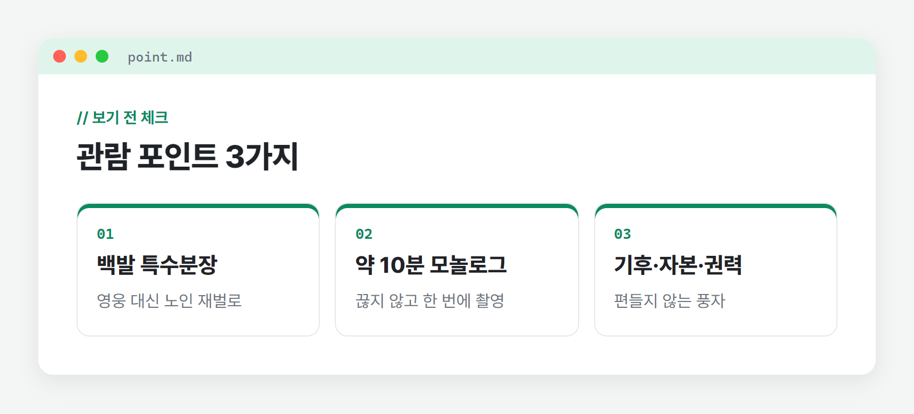

<!--
==================== 작성 메모 (발행 시 삭제) ====================
글 종류 : 단일 작품 리뷰 (극장 개봉작, 넷플릭스 작품 아님)
권장 발행일 : 2026-11-02 ~ 11-05 (국내 개봉 10-03. '공개 후 1~3일' 시점은 지났으므로 가능한 한 빨리 발행)
발행 주제 분류 : 영화

[썸네일] 1080x1080, 글씨 화면 25% 이하, 라벨 + 2줄
  라벨 : 영화 리뷰
  1줄 : 톰 크루즈 × 이냐리투
  2줄 : 호불호 갈린 작품 🍿
  이미지 : 제작 완료된 대표 이미지 사용 (수정하지 않음)
  파일 : images/thumbnail.png

[발행 전 꼭 할 일]
  1. ✍️ 표시 4곳을 직접 쓴 경험 문장으로 채우기
  2. 영화진흥위원회 통합전산망(KOBIS)·영상물등급위원회에서 러닝타임·관람 등급 재확인, 출처 줄 확인 날짜 채우기
  3. [이미지: …] 자리에 워너브러더스코리아 공식 배포 포스터·스틸 넣기. 이 작품은 넷플릭스 작품이 아니므로 캡션에 ⓒ Netflix를 쓰지 않는다. 캡션의 [배급사 저작권 표기 확인] 자리를 공식 표기로 바꾸기
  4. [내 글 링크] 자리에 관련 글 링크 넣기 (없으면 문장 삭제)
  5. 발행 시점에 극장 상영 여부를 예매 사이트에서 확인하고, 마무리 문단의 상영 안내 문장을 맞게 고치기 (넷플릭스 등 스트리밍 공개 정보는 없음)

[사용한 출처] (research.md 번호)
  [1] TV리포트, 2026-09-10  https://tvreport.co.kr/movie/article/1074616/  - 국내 개봉일, 그린란드 시추 시설 설정, '꼰대 괴짜 재벌' 소개
  [2] bnt뉴스, 2026-09-10  https://v.daum.net/v/P9gDArRfdY  - 공공의 적이 된 디거의 사태 수습 설정, 연기파 배우 소개
  [3] YTN, 2026-09-30  https://v.daum.net/v/20260930090407056?f=p  - 러닝타임 129분, 15세 이상 관람가, 경고를 무시하는 설정, 풍자 대상, 호평 요지
  [4] MTN, 2026-10-01  https://news.mtn.co.kr/news-detail/2026100115045898795  - 기자간담회, 약 9년 준비, 10분 모놀로그 원테이크, 인간 본성 발언
  [5] 텐아시아, 2026-10-01  https://www.tenasia.co.kr/article/2026100177164  - 13번째 내한, 특수분장, 제작 참여, 탑건: 매버릭 일화, 원테이크 3~4번
  [6] 엑스포츠뉴스, 2026-10-01  https://www.xportsnews.com/article/2203001  - 풍자 대상(미국 우선주의·물질만능주의), 감독 불참
  [8] Gulf News, 2026-10-05  - 북미 첫 주말 성적, 19년 만의 최저 오프닝
  [9] 헤럴드경제 미주판, 2026-10-06  https://www.heraldk.com/article/2026100607264416395  - 북미 첫 주말 성적, 19년 만의 최저 오프닝
  [11] 텐아시아, 2026-10-12  https://www.tenasia.co.kr/article/2026101263204  - 국내 누적 관객(10월 11일 기준)
  [12] MHN, 2026-10-12  https://mhnse.com/news/articleView.html?idxno=1589011  - 국내 누적 관객(10월 11일 기준)
  [14] World of Reel, 2026-09-29  - 옹호 평 요지, 로튼토마토 53%
  [15] Rotten Tomatoes, 2026-11-02 확인  https://www.rottentomatoes.com/m/digger_2026  - 평론가 53%, 관객 77%, 총평 요지, 미국 R 등급 사유
  [16] Metacritic, 2026-11-02 확인  https://www.metacritic.com/movie/digger-2026/  - 46점, BBC 평 요지, 미국 등급
  [18] 영문 위키백과  - 배역명(산드라 휠러·존 굿맨·제시 플레먼스), 9월 22일 런던 월드 프리미어
  [19] Warner Bros. Discovery 공식 타이틀 페이지  https://ed.wbd.com/titles/digger  - 출연진, 공식 시놉시스 취지

[확인 필요]
  - 러닝타임: 국내 소스는 YTN의 129분 1건뿐이고 해외 집계는 128분·129분으로 엇갈린다. 본문은 "129분(해외 집계 128분)"으로 썼다. KOBIS에서 확인 후 수정
  - 관람 등급: 15세 이상 관람가는 YTN 리뷰 1건뿐이라 정보 목록에 "개봉 리뷰 기준"을 붙였다. 영상물등급위원회에서 확인 후 표시 삭제
  - 로튼토마토 관객 지수 77%: 로튼토마토 한 곳(11월 2일 확인)만 출처라 날짜를 붙였다. 발행 당일 수치 재확인
  - 메타크리틱: 44점(9월 29일)과 46점(11월 2일)이 엇갈려 최신 46점에 날짜를 붙였다
  - 국내 누적 관객: 97,114명은 기준일이 불분명해 쓰지 않고, 두 매체가 같은 수치를 쓴 10월 11일 기준 약 7만 명만 썼다. 최신 수치는 KOBIS에서 확인
  - 시네마스코어(C+/C), 제작비, 손익분기점, 손실 전망: 매체마다 달라 본문에서 뺐다
  - 국내 평론가 평점(이동진·박평식·김성훈), 씨네21 전문가 평점, 네이버 실관람객 평점, 앤 해서웨이·벤 애플렉 등의 옹호 발언: 허프포스트코리아 단일 소스라 쓰지 않았다
  - 넷플릭스 개발 이력과 'Blah, Blah, Blah' 제목, 35mm 비스타비전·촬영감독 등 위키백과 단독 정보: 쓰지 않았다
  - 넷플릭스·VOD 등 스트리밍 공개: 정보가 없어 본문에서 다루지 않았다
  - 배역명(톰 크루즈 외): 위키백과 기준이다. 국내 공식 자료로 확인되면 그대로 두고, 다르면 고치기
  - 이미지 저작권 표기: 국내 공식 포스터·스틸 배포처와 표기(ⓒ Warner Bros. 등)를 확인하지 못했다
  - 스포일러(액자 구조, 결말, 톰 크루즈의 두 번째 배역명, 케니 관련 반전): 본문에 쓰지 않았다
==================================================================
-->

# 디거 톰 크루즈 블랙코미디 영화 출연진 줄거리 노스포 후기

**톰 크루즈 주연의 극장 개봉작 「디거」를 리뷰합니다.**

날카로운 풍자극을 좋아하는 분이라면 주목해야 됩니다. 알레한드로 G. 이냐리투 감독과 톰 크루즈가 처음 손잡은 영화 「디거」가 10월 3일 국내 극장에서 개봉했습니다.

흔한 톰 크루즈 액션 영화가 아닙니다. 재앙을 막던 액션 스타가 재앙을 부르는 석유 재벌로 돌아온, 평이 크게 엇갈린 블랙코미디였죠.

이번 포스팅에서는 기본 정보와 출연진, 줄거리 설정, 평이 갈린 이유를 정리하고, 누구와 보면 좋을지까지 스포 없이 살펴보겠습니다.

🔒 스포 없어요

## 디거 러닝타임과 등급은? 기본 정보 정리
러닝타임과 등급, 포스터를 살펴봅니다.

[이미지: 창 프레임 / 국내 공식 메인 포스터 - 백발로 분장한 톰 크루즈가 담긴 포스터]
메인 포스터 ⓒ [배급사 저작권 표기 확인]

러닝타임은 129분 안팎이고, 국내 관람 등급은 15세 이상 관람가입니다. 워너브러더스코리아가 배급해 2026년 10월 3일 개봉했습니다.

🎬 : 알레한드로 G. 이냐리투  
👫 : 톰 크루즈, 리즈 아메드, 존 굿맨, 산드라 휠러, 제시 플레먼스  

📍 : 블랙코미디, 재난 풍자극  
⏱️ : 129분 (해외 집계 128분)  
🚫 : 15세 이상 관람가 (개봉 리뷰 기준)  
📅 : 2026년 10월 3일 국내 극장 개봉  

출처: TV리포트(2026.09.10), YTN(2026.09.30), Warner Bros. Discovery 공식 페이지 · 영화진흥위원회 통합전산망 11월 __일 확인

디거 개봉까지의 일정

세계 첫 공개는 9월 22일 런던 월드 프리미어였습니다. 북미와 영국은 10월 2일, 우리나라는 하루 뒤 개천절에 개봉했습니다.

미국에서는 욕설이 많다는 이유로 R 등급을 받았습니다. 국내 등급과 러닝타임은 관람 전에 한 번 더 확인해 주세요.

## 출연진, 톰 크루즈의 낯선 변신
등장인물을 살펴봅니다.

[이미지: 창 프레임 / 공식 배포 스틸 중 백발에 배가 나온 디거 록웰(톰 크루즈)이 단독으로 담긴 장면]
디거 록웰 역의 톰 크루즈 ⓒ [배급사 저작권 표기 확인]

연기파 배우들이 한자리에 모여 풍자극에 무게를 더하는 출연진을 알아봅니다.

1️⃣ 톰 크루즈

3대째 석유 재벌 디거 록웰을 연기하고, 제작자로도 참여했습니다. 액션 영웅의 얼굴을 덜어내고 백발에 배가 나온 노인으로 특수분장을 하고 나타났습니다.

기자간담회에서는 분장을 연기에 어떻게 녹이느냐가 중요했다고 말했습니다. 억양과 걸음걸이까지 설계해 반복 연습했다고 해, 목소리와 몸짓의 변화를 눈여겨볼 만합니다.

2️⃣ 산드라 휠러

엠마 록웰 역을 맡았습니다. 국내 개봉 보도에서 존 굿맨, 제시 플레먼스와 함께 연기파 배우로 소개된 이름입니다.

3️⃣ 존 굿맨 · 제시 플레먼스

존 굿맨은 미국 대통령 컴슨을, 제시 플레먼스는 케니 록웰을 연기합니다. 권력과 재벌 가문을 비추는 인물들이 톰 크루즈 곁에서 이야기를 받쳐 줍니다.

✍️ [직접 작성: 톰 크루즈의 분장한 모습이나 연기에서 가장 인상 깊었던 점을 노스포로 1~2문장. 액션 영화 속 모습과 비교하면 좋음]

## 디거 줄거리, 어떤 이야기일까?
어떤 이야기인지 살펴봅니다.

[이미지: 창 프레임 / 공식 배포 스틸 중 그린란드 빙하 위 시추 시설이 담긴 장면]
빙하 시추 시설 장면 ⓒ [배급사 저작권 표기 확인]

괴짜 재벌의 그린란드 빙하 시추 시설에 생긴 작은 균열이 전 세계를 흔드는 재앙으로 번지는 이야기입니다.

주인공 록웰은 균열을 가볍게 여기고, 경고가 이어져도 손해를 볼 수 없다며 시추를 멈추지 않습니다. 결국 공공의 적이 된 그는 자신이 인류를 구할 사람이라고 증명하려 나섭니다.

국내 매체들은 이 영화를 미국 우선주의와 물질만능주의를 꼬집는 풍자극으로 소개했습니다. 기후 위기와 자본, 권력을 두루 겨냥하면서 어느 한쪽 편을 들지 않는다는 평도 있었습니다.

톰 크루즈에 따르면 이냐리투 감독은 이 작품을 약 9년 동안 준비했습니다. 『탑건: 매버릭』 촬영 첫날 감독의 연락을 받고, 오토바이를 몰고 찾아가 밤새 이야기를 나눴다는 일화도 전했습니다.

## 평이 엇갈린 이유와 관람 포인트
평단 반응과 눈여겨볼 지점을 정리합니다.

디거 평론가와 관객 반응 비교

로튼토마토 평론가 지수는 53%, 관객 지수는 77%입니다(11월 2일 확인). 메타크리틱 점수는 46점으로(11월 2일 확인), 평론가보다 관객 쪽 반응이 조금 더 따뜻한 편입니다.

로튼토마토 총평은 연출이 지나치게 계산되어 있어 일부 웃음이 잘 살지 않는다고 짚었습니다. 반면 크고 대담한 시도라며 평단이 너무 가혹하다고 맞선 해외 평론가도 있었습니다.

BBC 평론가는 좋거나 싫거나 둘 중 하나일 영화라고 했습니다. 호불호가 갈린다는 것 자체가 이 영화의 성격을 보여 주는 셈이죠.

흥행은 아쉬웠습니다. 북미 첫 주말 약 800만 달러로 5위에 그쳐, 2007년 이후 톰 크루즈 주연작 가운데 가장 낮은 오프닝을 기록했습니다. 국내 누적 관객도 10월 11일 기준 약 7만 명에 머물렀습니다.

디거 관람 포인트 3가지

관람 포인트로는 약 10분 길이의 모놀로그 장면이 꼽힙니다. 톰 크루즈는 이 장면을 끊지 않고 한 번에 찍었고, 3~4번 만에 마쳤다고 밝혔습니다.

웃음이 터지는 장면보다 웃다가 불편해지는 순간을 따라가 보면 풍자의 결이 더 잘 보입니다.

✍️ [직접 작성: 블랙코미디 톤이 나에게 웃겼는지, 불편했는지 솔직한 노스포 감상 1~2문장. 10분 모놀로그 장면을 본 인상이 있으면 함께]

## 누구와 보면 좋을까?
함께 보기 좋은 사람과 상황을 살펴봅니다.

[이미지: 창 프레임 / 공식 배포 스틸 중 주요 출연진이 한 화면에 함께 담긴 장면]
주요 출연진이 함께한 장면 ⓒ [배급사 저작권 표기 확인]

👥 : 혼자 퇴근 후 차분하게 보기를 권합니다. 2시간이 넘는 풍자극이라 웃음보다 생각할 거리를 곱씹으며 볼 때 더 잘 맞습니다.

👥 : 시사 이야기를 즐기는 친구와 주말에 봐도 좋습니다. 기후 위기와 재벌, 권력을 두고 보고 나서 나눌 대화거리가 많습니다.

톰 크루즈의 시원한 액션을 기대한 분이라면 실망할 수 있습니다. 15세 이상 관람가이고 미국에서는 욕설이 많아 R 등급을 받은 만큼, 어린아이와 보기에는 맞지 않습니다.

아이를 오래 돌봐 온 입장에서 보면, 거친 말이 이어지고 재난을 소재로 한 영화는 초등학생 이하 아이에게 부담이 될 수 있습니다. 가족 나들이 영화로는 다른 작품을 고르는 편이 좋겠습니다.

✍️ [직접 작성: 내가 이 영화를 본 시간·장소·함께 본 사람과, 다시 본다면 누구와 보고 싶은지 1~2문장]

## 보기 전 정리와 한 줄 후기
한 줄 총평과 추천 대상을 정리합니다.

「디거」는 톰 크루즈가 영웅 대신 재앙을 부르는 재벌을 맡아, 기후와 자본, 권력을 한꺼번에 비튼 블랙코미디입니다. 평은 갈렸지만 위험을 감수한 시도를 보고 싶은 분께는 볼 이유가 분명합니다.

극장 상영 여부는 관람 전에 예매 사이트에서 확인해 주세요. 풍자 영화를 더 찾고 있다면 [내 글 링크]도 함께 참고해 주세요.

✍️ [직접 작성: 직접 본 뒤의 한 줄 총평과 추천 여부. 기대와 달랐던 점이 있으면 노스포로 함께]

#디거 #톰크루즈 #이냐리투 #블랙코미디 #풍자영화 #영화추천 #극장개봉영화 #혼자보기좋은영화 #노스포후기
