MUSINSA BEAUTYBRAND ENTRY PROPOSAL2026 WINTER

# ZEROID

× **MUSINSA BEAUTY**

WINTER DRY CAREBEST

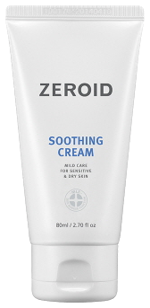 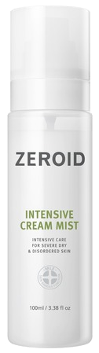 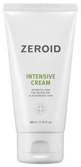 SOOTHING CREAM / INTENSIVE CREAM MIST / INTENSIVE CREAM

HEATER ON · HUMIDITY LOW · BARRIER ON

## 출근부터 퇴근까지, *직장인 피부*엔 제로이드

하루 9시간 **히터 바람 아래**에서 마르는 2030 직장인의 겨울 피부. 병·의원에서 먼저 찾던 피부장벽 보습 브랜드가 답합니다.

BRAND

제로이드 ZEROID · (주)네오팜

SINCE

2002 · 전국 병·의원 유통 · 해외 12개국 수출

THEME

2030 직장인 겨울 건조 피부 · 9 to 6 장벽 보습

CONTACT

\[담당자명\] · \[연락처\] · \[이메일\]

HEATER ON 9 HOURSINNER DRYNESS AT 3PMBARRIER CARE FROM 9 TO 6MLE® · DEFENSAMIDE™10 FREEOLIVE YOUNG 4.8 / 14,336 REVIEWS HEATER ON 9 HOURSINNER DRYNESS AT 3PMBARRIER CARE FROM 9 TO 6MLE® · DEFENSAMIDE™10 FREEOLIVE YOUNG 4.8 / 14,336 REVIEWS

00

Summary

## 제안 내용을 *한 장으로*

제로이드 전 라인의 무신사 뷰티 입점과, 이번 겨울 ‘9 to 6 윈터 배리어’ 런칭을 제안합니다.

WHY ZEROID

### 병원에서 시작해 올리브영에서 검증된 장벽 브랜드

- 2002년 런칭, 전국 병·의원 유통
- 올리브영 인텐시브 크림 리뷰 14,336건 · 4.8
- 올리브영 37개 제품 판매, 베스트 다수

WHY NOW

### 히터 아래 직장인의 겨울 건조 시즌

- 11–2월 겨울 보습 수요 집중
- 2026년 9–10월에도 ‘건조·당김’ 리뷰가 이어짐
- 올리브영 다음 채널로 2030·남성 접점 확대

OUR ASK

### 전 라인 입점 + 겨울 기획전 런칭

- 화장품 6개 라인 31종 입점
- 11–2월 오피스 겨울 보습 기획전 편입
- 런칭 기간 메인·랭킹 노출 \[협의\]

FOR MUSINSA

### 무신사에서만 만나는 구성과 지원

- 올리브영 동일가 + 무신사 단독 구성
- 겨울 세트 4종·묶음·남성 키트 단독 \[협의\]
- 12월 첫 주 오픈 목표, 체험단·콘텐츠 지원

01

Winter Office

## 히터 아래 9시간, *직장인 피부는 마릅니다*

찬바람과 히터 바람을 하루에도 몇 번씩 오가는 겨울. 2030 직장인의 피부는 출근부터 퇴근, 잠들기 전까지 쉬지 않고 수분을 잃습니다.

08:30출근 · 영하의 찬바람

#### 문을 나서자마자 당김

찬바람에 입가와 볼이 트고, 마스크를 벗을 때마다 따갑습니다.

10:00사무실 · 히터 시작

#### 건조한 실내 공기

히터가 켜지면서 아침에 바른 보습제가 빠르게 마릅니다.

15:00히터 바람 정점

#### 속당김 · 화장 들뜸

겉은 번들거리는데 속은 당기고, 볼 각질 위로 메이크업이 들뜹니다.

19:00퇴근 · 다시 찬바람

#### 따가운 퇴근길

실내외 온도 차가 큰 퇴근길, 하루치 건조함이 한꺼번에 느껴집니다.

23:00난방 켠 방

#### 밤새 마르는 피부

다음 날 아침까지 수분을 붙잡아 둘 마지막 시간입니다.

HEATER ON · 9 HOURS

**120**‘건조·당김·각질’을 말한 제로이드 리뷰

**52**‘겨울’을 직접 언급한 리뷰

**10**‘사무실·회사·출퇴근’ 환경을 언급한 리뷰

그래서 제로이드는 수분을 덧바르는 대신,\
*수분이 빠져나가지 않는 장벽*부터 채웁니다.

리뷰 수치: 제로이드 공식 홈페이지 리뷰 429건 본문 키워드 기준

02

Brand

## 병원에서 시작된 *24년* 장벽 연구

피부 고민으로 병원을 찾던 사람들을 위해, 전문가의 노하우와 연구원의 도전으로 만든 메디컬 스킨케어 브랜드입니다.

TECHNOLOGY**독자 장벽 기술 MLE®**

피부 지질 구조를 그대로 재현한 네오팜 기술

CONFIDENCE**10 FREE**

전 제품 피부 자극 테스트 완료

DIVERSITY**6개 라인 31종**

악건성부터 지성 트러블, 선케어까지

TRUST**병·의원 유통**

전국 병·의원에서 만나는 브랜드

2002

제로이드 브랜드 런칭

2009

수딩 라인 리뉴얼

2010

인텐시브 고보습 라인 출시, 싱가포르·인도네시아 수출

2011

디펜사마이드™ 인코스메틱스 혁신 성분상 은상

2012

더마뉴얼 라인 출시

2014

MD 의료기기 인증, 핌프로브 라인 출시

2019

루트힐 두피 라인 출시

2020

미국 등 해외 12개국 수출

03

Science

## 히터가 뺏는 수분, *장벽이 붙잡습니다*

건조한 실내에서 피부장벽이 약해지면 수분이 더 빨리 빠져나갑니다. 제로이드의 MLE®는 피부 지질과 같은 구조로 장벽을 채워 수분을 지킵니다.

STEP 01 · WINTER**장벽 약화**

건조한 공기에 장벽이 약해지면 수분이 많이 빠져나가고 외부 자극이 쉽게 들어옵니다.

STEP 02 · ZEROID**MLE® 보충**

피부지질 유사성분 MLE®가 피부장벽을 튼튼하게 채웁니다.

STEP 03 · RESULT**장벽 정상화**

적정 수분을 유지하고 외부 자극으로부터 피부를 지킵니다.

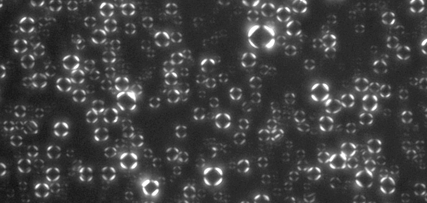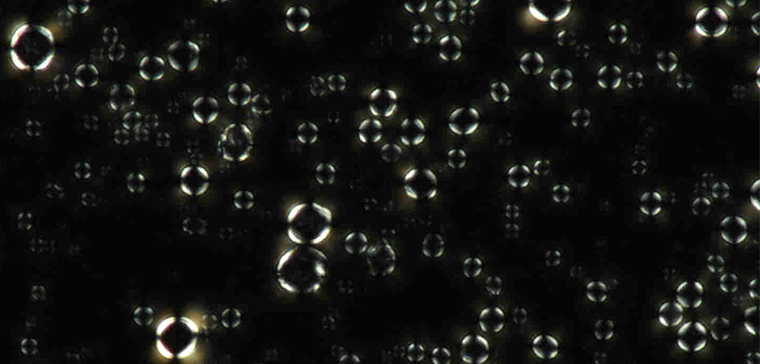

SKIN LAMELLARMLE LAMELLAR®

편광현미경 · 피부 지질과 MLE® 제형에서 같은 십자형 무늬(몰타크로스)가 나타납니다.

MLE®

네오팜 독자 기술 세라마이드-9S로 피부의 다중층상구조를 재현한 제형. 건조하고 민감한 피부의 보호·보습 기능 강화를 돕습니다.

DEFENSAMIDE™

장벽이 약해지면 떨어지는 피부 방어력을 강화하는 성분. 2011 인코스메틱스 혁신 성분상 은상.

10 FREE

색소향료에탄올파라벤미네랄오일페녹시에탄올PG벤질알코올BHT트리에탄올아민

04

Products

## 겨울 사무실을 위한 *대표 8종*

제로이드 전 라인 31종의 입점을 제안합니다. 그중 겨울 건조 케어 6종(하늘색)과 사계절 스테디셀러 2종을 앞세웁니다.

BEST·NEW는 공식 홈페이지 표기 · 올리브영 수치는 2026.10.28 올리브영 온라인몰 기준, 올리브영에 없는 제품은 홈페이지 리뷰 수 · 의료기기(MD) 6종과 써지엔젤 플러스는 병·의원 전용으로 제외

05

Reviews

## 올리브영에서 *지금도 쌓이는* 리뷰

올리브영 온라인몰의 제로이드 대표 제품 리뷰를 모았습니다. 수만 건의 리뷰가 쌓였고, 2026년 9–10월에도 건조·당김 리뷰가 계속 올라오고 있습니다.

**4.8**인텐시브 크림 평점 · 리뷰 14,336건

**4.8**수딩 크림 평점 · 리뷰 10,456건

**75%**‘자극 없이 순해요’ · 인텐시브·수딩 크림

**76%**‘보습에 좋아요’ · 크림 미스트

| 올리브영 대표 제품 | 평점 | 리뷰 수 | 고객 평가 (올리브영 리뷰 요약) |
| --- | --- | --- | --- |
| 인텐시브 크림 80+50ml 기획 | 4.8 | 14,336 | 건성에 좋아요 47% · 보습에 좋아요 65% · 자극 없이 순해요 75% |
| 수딩 크림 80+50ml 기획 | 4.8 | 10,456 | 복합성에 좋아요 57% · 보습에 좋아요 54% · 자극 없이 순해요 75% |
| 데일리 선크림 50ml | 4.8 | 1,953 | 복합성에 좋아요 66% · 발림성 아주 만족 66% · 자극 없이 순해요 75% |
| 인텐시브 크림 미스트 100ml | 4.9 | 86 | 건성에 좋아요 61% · 보습에 좋아요 76% · 자극 없이 순해요 79% |

출처: 올리브영 온라인몰 상품 상세 리뷰 요약 (2026.10.28 확인) · 리뷰 수는 같은 내용물의 다른 구성 상품 리뷰를 합산해 보여주는 올리브영 표기 기준

### 2026년 9–10월 올리브영 최신 리뷰

“추석 지나 얼굴이 바짝 말라서, 저녁 샤워 후 듬뿍 바르고 자요.”인텐시브 크림 · 민감성 · 2026.09.28

“요즘 쉽게 건조해지고 당겼는데, 무겁지 않게 촉촉해요.”수딩 크림 · 건성 · 2026.09.24

“갑자기 추워져 물 토너로는 건조했는데, 크림 미스트는 보습감이 좋아요.”크림 미스트 · 민감성 · 2026.10.22 · 체험단

“피부과 추천으로 쓰는데, 지성인데도 환절기에 잘 쓰고 있어요.”인텐시브 크림 · 지성 · 2026.10.08 · 매장 구매

리뷰 문장은 원문을 짧게 요약했습니다

### 홈페이지 리뷰 429건에 자주 나온 이야기

건조·당김·각질

120

정착·재구매·몇 년째

91

겨울

52

남편·남자친구·아들

30

사무실·회사·출퇴근

10

하늘색 막대는 겨울·건조·사무실 관련 · 한 리뷰가 여러 항목에 포함될 수 있음

홈페이지 리뷰 429건(2020–2024) 본문 키워드 기준 · 네이버 스마트스토어 리뷰 \[추가 예정\]

06

Why Musinsa

## 올리브영에서 검증된 브랜드, *무신사에서 넓힙니다*

제로이드는 병·의원에서 시작해 올리브영에서 대중성을 검증받았습니다. 다음은 패션과 함께 뷰티를 사는 무신사의 2030·남성 고객입니다. 같은 네오팜의 아토팜이 이미 무신사에서 판매 중이어서 운영 경험도 갖추고 있습니다.

37

올리브영 판매 중인 제로이드 제품 수 · 검색 결과 첫 페이지 24개 중 11개 BEST 표시

14,336

인텐시브 크림 올리브영 리뷰 · 평점 4.8 · ‘2025 어워즈’ 표기 상품

10,456

수딩 크림 올리브영 리뷰 · 평점 4.8

피부과에서 처방받다가, 더 싸게 사거나 작은 용량이 필요할 때 여기서 산다.

인텐시브 크림 · 올리브영 · 2026.09.23

병원에서 시작해 올리브영에서 검증된 제로이드,\
*무신사에서 2030 직장인을 새로 만납니다.*

07

Market

## 무신사 장벽 크림 시장, *제로이드의 자리*

무신사에서 ‘장벽크림’을 검색하면 1,301개 상품이 나오지만, 제로이드는 아직 없습니다. 무신사에서 이미 팔리고 있는 대표 더마 장벽 크림과 비교했습니다.

| 브랜드 · 제품 | 판매 채널 · 가격 | 평점 (리뷰) | 무신사 운영 특징 |
| --- | --- | --- | --- |
| 에스트라 아토베리어365 크림 80ml | 무신사 26,400원 | 4.9 (2만+) | 2·3개 묶음과 \[무신사 단독\] 구성 운영, 크림미스트 120ml 17,940원 |
| 디마프 크림스컴트루 배리어 리페어크림 50ml | 무신사 28,880원 | 4.9 (566) | ‘장벽크림’ 검색 상위 노출, 쿠폰·사은품 |
| 일리윤 세라마이드 아토 집중 크림 500ml | 무신사 26,800원 | 4.9 (232) | 대용량 가성비, 로션 묶음 세트 다수 |
| 아토팜 MLE 크림 160ml × 2 (같은 네오팜) | 무신사 65,000원 | 5.0 (63) | MLE 기술 공유, 2개 묶음 중심 72개 상품 |
| 제로이드 인텐시브 크림 80ml | 올리브영 28,800원 (정가 32,000원) | 4.8 (14,336) | **무신사 미입점** · 이번 제안 |

출처: 무신사·올리브영 온라인몰 검색 결과 (2026.10.28 확인) · 할인 적용 판매가 기준이며 행사에 따라 달라짐 · 평점은 각 몰 표기 기준

PRICE**주력 경쟁 제품과 같은 가격대**

80ml 크림 기준 2만 원 후반대로 에스트라·디마프와 나란히 섭니다.

HERITAGE**병·의원 출신 더마 브랜드**

24년간 병·의원에서 쓰여 왔고, 의료기기(MD) 라인까지 갖춘 브랜드입니다.

TECH**MLE® · 10 FREE**

피부 지질 구조를 재현한 제형과 10가지 무첨가 설계

STORY**9 to 6 직장인 겨울 케어**

경쟁 브랜드가 아토·민감 피부를 말할 때, 제로이드는 직장인의 하루를 말합니다.

08

9 to 6 Persona

## 겨울 사무실의 *네 가지 건조 피부*

무신사 뷰티의 핵심 고객인 2030 직장인을 히터 아래 겨울 건조 상황에 맞춰 네 명으로 나눴습니다. 퍼소나는 가상의 인물이고, 리뷰는 실제 리뷰를 요약했습니다(원문 번호 #).

PERSONA 01 · DRY SKIN

### “오후만 되면 얼굴이 쩍쩍 당겨요”

지수, 29세 · 회계팀 대리

자리 바로 위가 히터 송풍구 · 하루 9시간

인텐시브 크림

크림 미스트

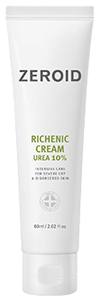

리케닉 크림

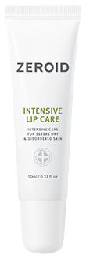

립케어

피부

건성 · 민감성

겨울 증상

볼과 입가가 트고 손등까지 거칠어짐, 오후면 크림이 다 날아감

고민

덧바르자니 메이크업이 무너지고, 안 바르자니 당김

쇼핑

무신사에서 겨울 아우터와 함께 보습템을 장바구니에 담음

만족 지점

퇴근해서 집에 와도 건조하다는 느낌이 없는 것

07:30기상

#### 밤새 마른 피부

난방 켠 방에서 자고 나면 볼이 당김

인텐시브 크림을 베이스로

“아침부터 결이 부드러워요”

08:30출근길

#### 찬바람에 트는 입가

마스크 벗을 때마다 입술이 갈라짐

인텐시브 립케어

“각질 없이 출근해요”

15:00히터 아래

#### 오후의 속당김

크림은 사라지고 화장은 들뜸

크림 미스트를 화장 위로

“자리에서 바로 덧뿌려요”

19:00퇴근

#### 따가운 퇴근길

예전엔 퇴근하면 얼굴이 따가움

인텐시브 크림 + 리케닉 크림

“건조하다는 느낌이 없어요”

23:00잠들기 전

#### 거친 결 정리

볼·팔꿈치·손등의 거친 결

리케닉 크림을 한 겹 더

“다음 날 결이 달라요”

**리케닉 크림 + 인텐시브 크림**★★★★★

건성 · 민감성사무실 건조#15267

##### “건조한 사무실에서 일하고 와도 당기지 않아요”

BEFORE

민감성이 된 뒤 어떤 제품을 발라도 화끈거렸지만 제로이드만은 괜찮아 몇 년째 쓰고 있습니다.

HOW

인텐시브 크림을 베이스로, 건조한 가을·겨울·봄에는 리케닉 크림을 함께 바릅니다.

AFTER

건성인데도 사무실에서 하루를 보내고 와도 건조함을 거의 느끼지 않는다고 적었습니다.

**인텐시브 크림 미스트**★★★★★

올리브영 2026.10.22민감성급추위체험단

##### “갑자기 추워진 날, 물 토너 대신 크림 미스트”

BEFORE

날씨가 급격히 추워지자 물 같은 토너로는 건조함이 가시지 않았습니다.

HOW

토너 대신 크림 미스트를 뿌려 보습했습니다.

AFTER

보습감과 사용감이 좋았고, 피부과에서 쓰던 브랜드라 믿고 쓴다고 적었습니다.

**NOTE** · 올리브영 체험단으로 제품을 제공받아 작성된 후기입니다.

PERSONA 02 · INNER DRY

### “기름은 도는데 속은 사막 같아요”

하은, 27세 · 마케터

히터 + 마스크 + 잦은 미팅 · 하루 종일

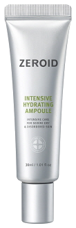

하이드레이팅 앰플

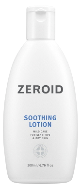

수딩 로션

수딩 크림

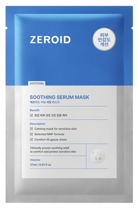

수딩 세럼 마스크

피부

복합성 수부지 · 이마·코는 지성, 볼은 속건조

겨울 증상

히터에 속당김이 심해지고, 볼 각질 위로 화장이 들뜸

고민

무거운 크림은 트러블, 가벼운 제품은 금방 당김

쇼핑

성분과 후기를 비교하고 무신사 랭킹을 참고

만족 지점

겉은 보송하고 속은 촉촉한 ‘속보습’

07:40세안 후

#### 세안 직후 속당김

스킨을 바르면 오히려 따가운 날

스킨 대신 하이드레이팅 앰플부터

“시작부터 덜 당겨요”

08:00메이크업 전

#### 들뜨지 않는 베이스

각질 위에 파운데이션이 뜸

수딩 로션 한 겹 (T존은 얇게)

“속은 촉촉, 겉은 보송”

14:00히터·마스크

#### 번들과 속건조 동시

마스크 속 트러블, 볼은 당김

아침에 볼에만 수딩 크림 덧바름

“유수분이 맞춰져요”

21:00집

#### 달아오른 볼

하루 종일 히터에 달아오른 볼

수딩 세럼 마스크

“열감이 가라앉아요”

+10M10개월 뒤

#### 계절이 바뀌어도

여름이 오면 크림이 무거워짐

같은 라인 수딩 로션으로 전환

“홍조도 사라졌어요”

**수딩 크림**★★★★★

복합성 · 민감성겨울 장벽 손상#16544

##### “겨울에 무너진 수부지 장벽, 10개월의 기록”

BEFORE

지난 겨울 장벽이 무너진 상태에서 각질 제거까지 과하게 해 홍조와 트러블로 뒤덮였습니다.

HOW

예민할 땐 스킨 없이 보습제 하나만, 건조하면 스킨 대신 앰플부터 시작했습니다.

AFTER

저자극·속건조 해결·장벽 개선을 장점으로 꼽았고, 여름엔 수딩 로션으로 바꿔 유수분을 유지했습니다.

**수딩 크림**★★★★★

올리브영 2026.09.24건성당김한달 이상 사용

##### “쉽게 당기는 요즘, 무겁지 않게 촉촉해요”

BEFORE

요즘 피부가 쉽게 건조해지고 당기는 느낌이 들어 쓰기 시작했습니다.

HOW

자기 전에 듬뿍 바르고, 아침저녁 데일리 보습크림으로 씁니다.

AFTER

무겁거나 답답하지 않으면서 촉촉하고, 다음 날 건조함이 덜하다고 합니다. 계절 상관없이 손이 가는 크림이라고 적었습니다.

PERSONA 03 · OILY BUT DRY

### “지성인데 겨울엔 얼굴이 따가워요”

도윤, 32세 · 영업직

찬바람 외근 ↔ 히터 켠 차·사무실 · 하루 여러 번

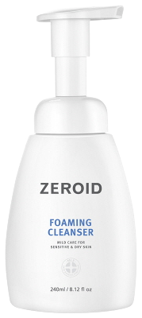

포밍 클렌저

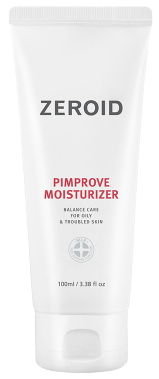

핌프로브 모이스처라이저

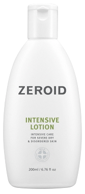

인텐시브 로션

인텐시브 크림

피부

지성 · 수분 부족, 면도 후 따가움

겨울 증상

T존은 번들거리는데 볼은 따갑고 당김

고민

지성이라 보습을 건너뛰다 겨울에 더 예민해짐

쇼핑

무신사에서 옷 사면서 기초를 같이 담음, 단계는 적을수록 좋음

만족 지점

번들거리지 않고 두 단계면 끝나는 것

07:00면도

#### 면도 후 따가움

면도 직후 붉어지고 당김

포밍 클렌저로 순하게 세안

“씻고 나서 안 당겨요”

07:20두 단계

#### 시간 없는 아침

여러 개 바르기 귀찮음

핌프로브 + 볼에만 인텐시브 로션

“두 개면 끝나요”

11:00외근

#### 찬바람 ↔ 히터

차 안 히터와 바깥 찬바람

얇게 여러 번 겹쳐 바른 크림

“퇴근까지 촉촉”

16:00사무실

#### 지성도 예민해지는 겨울

T존은 번들, 볼은 따가움

겨울엔 인텐시브 크림을 얇게

“번들거리지 않고 편해요”

SPRING봄이 오면

#### 계절에 맞춰 교체

날이 풀리면 크림이 무거움

다시 핌프로브 단독으로

“계절마다 같은 브랜드로”

**인텐시브 크림**★★★★★

올리브영 2026.10.08지성 · 트러블환절기매장 구매

##### “지성인데도 환절기에 잘 쓰는 장벽 크림”

BEFORE

지성에 트러블과 블랙헤드가 있는 피부입니다.

HOW

피부과 추천으로 인텐시브 크림을 쓰기 시작했고, 올리브영 매장에서 구매했습니다.

AFTER

지성인데도 부담 없이 환절기 내내 잘 쓰고 있다고 적었습니다.

**핌프로브 · 수딩 · 오인트 크림**★★★★★

수분부족 지성계절별 교체#16537

##### “계절마다 바꿔 쓰는 화장품 다이어트”

BEFORE

수분 부족형 지성으로 한 달의 절반 이상을 여드름에 시달렸습니다.

HOW

겨울엔 오인트 크림, 봄·가을엔 수딩 크림, 여름엔 핌프로브. 앰플과 크림 두 개만 바릅니다.

AFTER

여드름이 많이 줄고 보습감이 좋아졌으며, 바쁜 아침에도 단계가 단순해 부담이 없다고 합니다.

PERSONA 04 · OVERWORKED DRY

### “1일 1팩까지 했는데 더 건조해졌어요”

서연, 30세 · 브랜드 디자이너

마감 주간 야근 · 밤까지 히터 켠 사무실

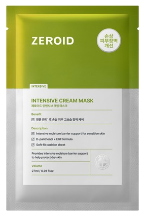

크림 마스크

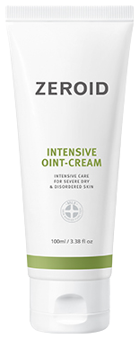

오인트 크림

하이드레이팅 앰플

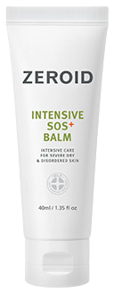

SOS 플러스 밤

피부

복합성\~건성, 반복되는 트러블

겨울 증상

야근 후 푸석하고, 다음 날 아침 화장이 먹지 않음

고민

마스크팩과 페이스 오일을 매일 써도 건조함이 계속됨

쇼핑

‘더 좋은 것’을 사 모으다 지쳐, 정착할 브랜드를 찾음

만족 지점

적게 발라도 아침까지 촉촉한 것

22:00야근

#### 밤까지 이어진 히터

늦게까지 사무실, 피부가 푸석

책상 서랍 속 SOS 플러스 밤

“건조한 부위만 콕”

00:30귀가

#### 지쳐도 한 가지는

여러 단계 바를 힘이 없음

인텐시브 크림 마스크 한 장

“붙이고 바로 잠들어요”

07:30다음 날

#### 푸석한 아침

회식 다음 날 화장이 안 먹음

앰플 + 오인트 크림 섞어 바르기

“일어나도 촉촉해요”

+2W2주 뒤

#### 덜어내는 루틴

마스크팩·오일 과다

크림 하나로 단순화

“트러블이 한 번도 없었어요”

+2Y2년 뒤

#### 정착

새 제품 찾아 헤매던 습관

제로이드 하나로 꾸준히

“오일은 이제 안 써요”

**인텐시브 크림**★★★★★

건성과관리 건조#15307

##### “1일 1팩과 오일을 끊고, 크림 하나로 2년”

BEFORE

건조해서 매일 마스크팩과 페이스 오일을 썼지만 트러블이 6개월 넘게 반복됐습니다.

HOW

피부과에 비치된 제로이드를 써 보고 직접 사기 시작해 2년 넘게 크림 하나만 씁니다.

AFTER

트러블이 한 번도 없었고, 이제 마스크팩과 오일 없이도 건조함을 거의 느끼지 않는다고 합니다.

**인텐시브 크림**★★★★★

올리브영 2026.09.28민감성밤 집중 보습

##### “바짝 마른 얼굴, 밤에 듬뿍 바르면 다음 날 화장이 먹어요”

BEFORE

날이 쌀쌀해지면서 얼굴이 바짝 마르는 느낌이 들었습니다.

HOW

저녁에 샤워한 뒤 나이트 케어로 듬뿍 바르고 잡니다.

AFTER

창문을 조금 열고 자도 다음 날 화장이 잘 먹는다며, 건성이라면 꼭 발라 보라고 추천했습니다.

09

Price

## 올리브영과 *같은 가격*, 무신사만의 혜택

무신사 고객이 다른 채널과 가격을 비교해도 망설이지 않도록, 단품은 올리브영 판매가와 맞추고 무신사에서는 단독 구성·사은품·쿠폰으로 차이를 만듭니다.

| 제품 | 정가 | 올리브영 판매가 | 무신사 제안 |
| --- | --- | --- | --- |
| 인텐시브 크림 80ml | 32,000원 | 28,800원 | 동일가 + 무신사 단독 묶음 \[가격 협의\] |
| 인텐시브 크림 80+50ml 기획 | 40,000원 | 31,500원 | 동일가 + 사은품 \[협의\] |
| 수딩 크림 80+50ml 기획 | 38,000원 | 29,900원 | 동일가 + 사은품 \[협의\] |
| 수딩 로션 160ml | 30,000원 | 27,000원 | 동일가 |
| 인텐시브 크림 미스트 100ml | 23,000원 | 17,900원 | 동일가 + 오피스 키트 구성 |
| 데일리 선크림 50ml | 32,000원 | 24,300원 | 동일가 |
| 인텐시브 오인트 크림 80ml | 35,000원 | 30,800원 | 동일가 |

올리브영 판매가는 2026.10.28 온라인몰 표시가(세일 반영, 쿠폰 제외)이며 행사에 따라 달라짐 · 무신사 판매가와 공급률은 미팅에서 확정

RULE 01**단품 가격은 맞춥니다**

올리브영 행사가보다 비싸지 않게 운영해 비교 이탈을 막습니다.

RULE 02**차이는 구성으로**

무신사에서만 파는 묶음·세트로 가격 비교가 안 되는 상품을 만듭니다.

RULE 03**런칭 혜택은 굵게**

오픈 2주간 첫 구매 쿠폰과 샘플 키트 증정 \[할인율·수량 협의\]

RULE 04**무리한 할인은 피합니다**

병·의원과 올리브영 가격 체계를 지키는 선에서 혜택을 설계합니다.

10

Musinsa Only

## 무신사에서만 만나는 *단독 기획*

올리브영에 없는 구성으로 무신사에서 사야 할 이유를 만듭니다. 퍼소나별 겨울 세트 4종을 중심으로, 묶음·남성·패션 연계 기획을 함께 제안합니다.

SET 01 · 건성**히터 오피스 키트**

인텐시브 크림 + 크림 미스트 + 립케어

책상 위에서 오후 3시 덧뿌림까지

SET 02 · 수부지**속건조 보습 세트**

앰플 + 수딩 로션 + 수딩 크림

스킨 대신 앰플로 시작하는 겨울 루틴

SET 03 · 지성 남성**겨울 지성 2-STEP**

포밍 클렌저 + 핌프로브 + 인텐시브 로션

면도 후부터 외근까지 두 단계

SET 04 · 야근**다음 날 SOS 세트**

크림 마스크 + 오인트 크림 + SOS 밤

야근 밤부터 다음 날 아침까지

BUNDLE**인텐시브 크림 2·3개 묶음**

겨울 내내 쓰는 고객을 위한 무신사 단독 묶음. 무신사에서 이미 익숙한 다개입 구성 방식입니다.

MEN**남성 그루밍 2-STEP**

포밍 클렌저 + 수딩 로션. 옷과 함께 장바구니에 담기 쉬운 남성 입문 구성입니다.

FASHION**아우터 구매 고객 보습 파우치**

무신사 아우터 구매 고객에게 미니 키트를 증정해 패션 고객을 뷰티로 연결합니다 \[협의\].

COLLAB**무신사 입점 브랜드 협업 파우치**

올리브영의 캐릭터 콜라보처럼, 무신사에서는 패션 브랜드와 한정 파우치를 만듭니다 \[협의\].

PDP**상세페이지**

‘히터 아래 하루’ 시간대별 루틴 컷과 현미경 비교 이미지

CAMPAIGN**겨울 오피스 기획전**

11–2월 직장인 겨울 보습 기획전, 아우터 구매 고객 대상 추천

REVIEW**체험단**

2030 직장인 체험단으로 최신 겨울 리뷰 확보

SEARCH**검색 키워드**

‘장벽크림’, ‘겨울 보습’, ‘수부지 크림’, ‘남자 로션’ 키워드 노출 \[협의\]

11

Year-round

## 겨울로 시작해 *사계절로* 이어집니다

겨울은 런칭 테마이고, 제로이드는 계절마다 맞는 라인이 있는 브랜드입니다. 리뷰에서도 계절에 따라 라인을 바꿔 쓰며 브랜드 안에 머무는 고객이 보입니다(#16537, #15373).

WINTER11–2월 · 런칭

#### 실내 건조 · 장벽 보습

인텐시브 크림, 크림 미스트, 리케닉 크림, 립케어

SPRING3–5월

#### 환절기 민감 · 진정

수딩 크림, 수딩 로션, 수딩 세럼 마스크

SUMMER6–8월

#### 피지 · 자외선

핌프로브 모이스처라이저, 데일리 선크림, 포밍 클렌저

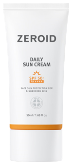

FALL9–10월

#### 환절기 장벽 회복

인텐시브 로션, 하이드레이팅 앰플 → 다시 겨울로

12

Timeline

## 11월 미팅, *12월 첫 주 오픈* (안)

겨울 수요가 가장 큰 12–2월을 놓치지 않도록 역산한 일정입니다. 무신사 입점 절차에 맞춰 조정하겠습니다.

W111.02–11.08**제안 미팅 · 조건 협의**

가격, 공급률, 단독 구성 범위

W211.09–11.15**계약 · 상품 정보 전달**

31종 상품 정보, 이미지, 단독 세트 확정

W311.16–11.22**상세페이지 제작**

9 to 6 루틴 컷, 현미경 비교 이미지

W411.23–11.29**등록 · 입고 · 체험단 모집**

상품 검수, 물류 입고, 2030 직장인 체험단

W511.30–12.06**그랜드 오픈**

런칭 혜택 2주, 겨울 오피스 보습 기획전 편입

W6–812월**리뷰 확보 · 연말 선물**

체험단 리뷰, 콘텐츠, 연말 선물 기획

1–2월한겨울**겨울 기획전 유지**

재구매 쿠폰, 묶음 상품 강화

3월\~봄**수딩 라인 전환**

사계절 로드맵의 봄 시즌으로 이동

13

Terms

## 입점 *조건 제안*

대괄호 항목은 미팅에서 함께 확정하고 싶은 부분입니다.

| 항목 | 제안 | 상태 |
| --- | --- | --- |
| 입점 SKU | 화장품 6개 라인 31종 (의료기기 제외) | 제안 |
| 가격 정책 | 단품은 올리브영 판매가와 동일, 차이는 단독 구성·사은품으로 | 제안 |
| 단독 상품 | 퍼소나별 겨울 세트 4종, 인텐시브 크림 묶음, 남성 2-STEP | 제안 |
| 런칭 시기 | 12월 첫 주 그랜드 오픈 목표 · 겨울 오피스 보습 기획전과 동시 | 협의 |
| 런칭 프로모션 | \[할인율 \_\_%\] · \[쿠폰\] · 구매 사은품 \[샘플 키트\] | 협의 |
| 거래 방식 · 공급률 | \[위탁 / 매입\] · \[\_\_%\] | 협의 |
| 마케팅 지원 | 체험단 \[\_\_명\] · 콘텐츠 \[\_\_건\] · 광고비 \[\_\_원\] | 협의 |
| 물류 · CS | \[출고 리드타임 \_\_일\] · \[배송 방식\] · CS 담당 \[\_\_\] | 확인 필요 |

ZEROID

(주)네오팜 · 무신사 뷰티 입점 제안 · 이미지 출처 zeroid.co.kr · 리뷰 데이터 출처 zeroid.co.kr, 올리브영 온라인몰 (2026.10.28 수집) · 퍼소나는 가상 인물이며 리뷰는 원문을 요약했습니다.