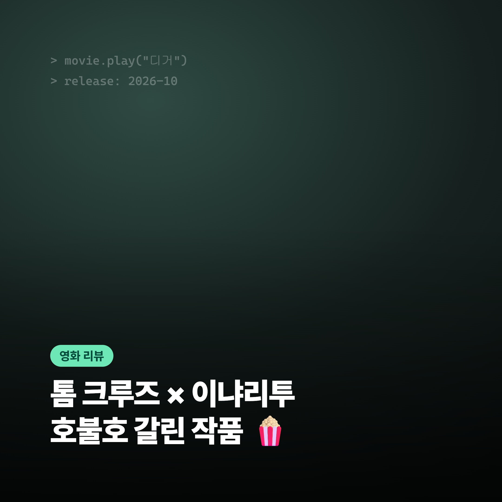

# 포트폴리오 · Claude Code 실습 프로젝트

Claude Code와 서브 에이전트 팀으로 만든 콘텐츠·기획 결과물 모음입니다.
각 프로젝트의 **바로 보기** 링크에서 최종 결과물을 바로 열어 볼 수 있습니다.

| # | 프로젝트 | 한 줄 소개 | 바로 보기 |
|---|---|---|---|
| 01 | [넷플릭스 추천 블로그 자동화](01_netflix-blog-automation/) | 주제만 주면 조사 → 원고 → 이미지 → 통합까지 자동으로 네이버 블로그 글 완성 | [완성 글 (디거 리뷰)](01_netflix-blog-automation/output/디거/final.md) |
| 02 | [영화제 입문자 관객 끌어오기 기획안](02_film-festival-newcomer-proposal/) | 12명 에이전트 팀이 리서치·기획·작성·검토를 반복해 만든 영화제 프로그램 기획안 | [최종 기획안](02_film-festival-newcomer-proposal/05_최종/기획안_최종.md) |
| 03 | [제로이드 × 무신사 뷰티 입점 제안](03_zeroid-musinsa-proposal/) | (주)네오팜 제로이드의 무신사 뷰티 입점 제안서 · 요약본 · 웹 제안서 · 피칭 자료 | [입점제안서 PDF (v34)](03_zeroid-musinsa-proposal/최종본/제로이드_무신사_입점제안서_최종_v34.pdf) |

---

## 01. 넷플릭스 추천 블로그 자동화



작품명·테마를 입력하면 서브 에이전트 4명이 순서대로 일해 네이버 블로그 글을 완성합니다.

| 단계 | 에이전트 | 하는 일 |
|---|---|---|
| 1 | researcher | 작품 정보·평가 조사 |
| 2 | writer | 스타일·SEO 가이드에 맞춘 원고 작성 |
| 3 | image-maker | HTML 템플릿 → PNG 이미지 제작 |
| 4 | assembler | 원고와 이미지를 합쳐 최종 HTML/MD 생성 |

**결과물**
- 📝 [완성 글 — 디거 리뷰 (final.md)](01_netflix-blog-automation/output/디거/final.md)
- 🔎 [조사 자료 (research.md)](01_netflix-blog-automation/output/디거/research.md)
- 🖼️ [이미지 폴더](01_netflix-blog-automation/output/디거/images/)

**구성 자료**: [가이드 (문체·SEO·이미지)](01_netflix-blog-automation/guides/) · [에이전트 정의](01_netflix-blog-automation/.claude/agents/) · [도구 스크립트](01_netflix-blog-automation/tools/) · [작업 규칙 (CLAUDE.md)](01_netflix-blog-automation/CLAUDE.md)

---

## 02. 영화제 입문자 관객 끌어오기 프로그램 기획안

국내 영화제 어디에나 적용할 수 있는 "입문자 관객" 유입 프로그램 기획안입니다.
검토자 3명(프로그래머·홍보·운영) 모두 채택 가능성 "상"이 나올 때까지 초안 v1 → v6을 반복했습니다.

- **독자**: 국내 영화제 프로그래머·홍보 담당자
- **핵심 프로그램**: 입문자 추천 코스 · 첫 방문 좌석 · 첫 영화제 가이드 · 체크인과 설문
- **KPI**: 첫 방문 관객 수, 만족도(D+30), 다음 해 재방문율

**결과물**
- 📄 [최종 기획안](02_film-festival-newcomer-proposal/05_최종/기획안_최종.md)
- 🖥️ [슬라이드 원본 (HTML)](02_film-festival-newcomer-proposal/06_슬라이드/project/slides/)

**작업 과정**: [01 리서치](02_film-festival-newcomer-proposal/01_리서치/) → [02 기획](02_film-festival-newcomer-proposal/02_기획/) → [03 초안](02_film-festival-newcomer-proposal/03_초안/) → [04 검토](02_film-festival-newcomer-proposal/04_검토/) → [05 최종](02_film-festival-newcomer-proposal/05_최종/) · [프로젝트 계획 (PLAN.md)](02_film-festival-newcomer-proposal/PLAN.md) · [에이전트 12명](02_film-festival-newcomer-proposal/.claude/agents/)

---

## 03. 제로이드 × 무신사 뷰티 입점 제안

(주)네오팜 제로이드(ZEROID)를 무신사 뷰티에 입점시키기 위한 제안 자료 일체입니다.
컨셉: **9 to 6 윈터 배리어 · 덧바르는 보습에서 지키는 보습으로** (타깃: 2030 직장인)

**결과물**
- 📕 [입점제안서 상세본 PDF (v34)](03_zeroid-musinsa-proposal/최종본/제로이드_무신사_입점제안서_최종_v34.pdf)
- 📗 [요약본 PDF (v34)](03_zeroid-musinsa-proposal/최종본/제로이드_무신사_입점제안서_요약본_최종_v34.pdf)
- 🌐 웹 버전 (Claude 아티팩트): [상세본](https://claude.ai/artifact/RSG2kEVWNrCkQSoCEuUesB) · [인터랙티브 웹 제안서](https://claude.ai/artifact/R61tRM4U6Zd29hccNGtuPy)
- 🎤 [피칭 스크립트 · 예상 질문](03_zeroid-musinsa-proposal/meeting/피칭스크립트_예상질문.md)
- 🔍 검토 자료: [무신사 MD 검토팀](03_zeroid-musinsa-proposal/review/무신사MD_검토팀.md) · [보강팀 대응 전략](03_zeroid-musinsa-proposal/review/보강팀_대응전략.md)

**기타**: [프로젝트 계획 (PLAN.md)](03_zeroid-musinsa-proposal/PLAN.md) · [버전별 최종 PDF](03_zeroid-musinsa-proposal/최종본/) · [버전별 HTML](03_zeroid-musinsa-proposal/versions/) · [브랜드 정보](03_zeroid-musinsa-proposal/zeroid_brand_info.md)

---

## 폴더 구조

```
├── 01_netflix-blog-automation/          넷플릭스 추천 블로그 자동화
├── 02_film-festival-newcomer-proposal/  영화제 입문자 관객 기획안
└── 03_zeroid-musinsa-proposal/          제로이드 × 무신사 입점 제안
```

> 02·03 폴더는 원래 별도 저장소였던 프로젝트를 커밋 기록과 함께 옮겨 왔습니다.
